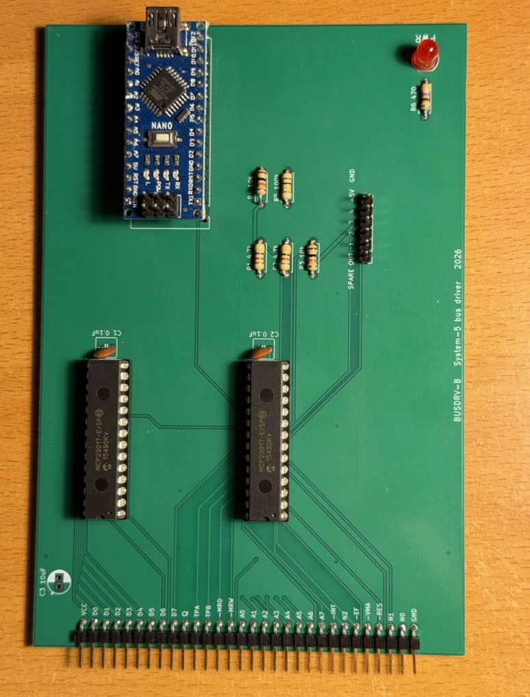

# Bus driver card: theory of operation

The bus driver is a 2026 test card, modelled on the YACC1 bus tester. An Arduino Nano, talked to over USB, drives the whole System-5 bus through two MCP23017 I/O expanders.
With the CPU card pulled it is the bus master: it runs memory and I/O cycles in the 1802's order, so each card can be tested on its own. With the CPU card in, it only watches the bus; it can also step the CPU card's clock from a spare pin and record every bus cycle ("Stepping the CPU" below).



*BUSDRV-B, the bus driver card (photo 2026-11-15).*

- **Rev B** (BUSDRV-B), `hardware/bus-driver/kicad/rev-b/`, generated from `gen/netlist.py`: ordered 2026-10-20, built and working since 2026-10-30. It has brought up the memory, IDE/CF and 6845 cards and traced the CPU card (the reports are `hardware/*/*/*/bringup/README.md`). Rev A (2026-10-09) is scrap: routed on four layers, made from a two-layer zip.
- Firmware: `embedded/bus-driver/s5-bus-driver/` (Arduino sketch; the command list is in its header). On the card: banner `blocks-1 io-2 clk-1 2026-10-31`.
- Host tool and card bring-up: `software/busdrv/` (`s5busdrv.py`, `bringup.py`, `cputrace.py`, `BRINGUP.md`).

## Parts

| Ref | Part | Job |
|---|---|---|
| A1 | Arduino Nano (ATmega328P; the CH340 clone used needs the old bootloader) | USB serial console; I²C master |
| U1 | MCP23017 at 0x20 | GPA0–6 = D0–D6, GPB0–6 = A0–A6, GPA7/GPB7 = SPARE1/2 |
| U2 | MCP23017 at 0x21 | GPA0–6 = D7, A7, TPA, TPB, -MRD, -MRW, -VMA; GPB0–6 = Q, -RESET, -INT, -EF, N0, N1, N2; GPA7/GPB7 = SPARE3/4 |
| J1 | System-5 bus, 30 pins | |
| J2 | header | SPARE1–4 (outputs only), +5 V, GND |
| R1, R2 | 4.7 kΩ | I²C pull-ups to bus +5 V |
| R3 | 10 kΩ | expander reset (XRST) pull-up |
| R4, R5 | 10 kΩ / 100 kΩ | bus +5 V sense into A0 |
| R6, D1 | 470 Ω, LED | bus power |
| C1–C3 | 0.1 µF, 0.1 µF, 10 µF | bypass and bulk |

## How it works

**Expanders on the bus.** All 28 bus signals sit on bidirectional expander pins (the MCP23017's GPA7/GPB7 are output-only on current silicon, so they are the spares). There are no buffers or series resistors: an expander pin is either an input (monitor) or drives the line.

**Safety.** At power-up every pin is an input: the card is a monitor. `MASTER:1#` takes the bus: it is refused if TPA/TPB are toggling (a CPU is running) or the bus has no power. It cannot tell a stopped CPU card from an empty slot, so pull the CPU card first. -RESET, -INT and -EF are open collector on the bus, so the card only pulls them low or releases them. While bus +5 V is off (sensed on A0) the expanders are held in reset and I²C is stopped, so nothing back-feeds them through the Nano's USB power.

**Bus cycles.** Each step is one I²C write at 400 kHz, so a byte takes about 1 ms: far slower than an 1802, but every edge comes in the 1802's order, which is all the static cards need.

| Cycle | Steps |
|---|---|
| Memory read | A0–A7 = high byte; TPA high, low; A0–A7 = low byte; -VMA low; -MRD low; TPB high; sample D0–D7; TPB low; -MRD high; -VMA high |
| Memory write | the same address steps; D0–D7 = data; -MRW low; TPB high, low; -MRW high; release D0–D7; -VMA high |
| `OUT n` | D0–D7 = data; -MRD low; N = n; TPA pulse; TPB pulse; N = 0; -MRD high; release D0–D7 |
| `INP n` | N = n; TPA pulse; TPB high; sample D0–D7; TPB low; N = 0 |

TPB inside memory cycles is for the 6845 card (its E); -MRD low in `OUT` is how the IDE and IO cards tell an `OUT` from an `INP`. Both were added on 2026-10-11 (firmware banner `io-2`) after `software/busdrv/fwsim.py`, which runs these same steps against the cards' netlists, showed the earlier firmware failing on both cards.

## Stepping the CPU

Added 2026-10-31 (firmware banner `clk-1`). The card stays a monitor and the CPU card drives the bus, but the 1802's clock comes from the bus driver: SPARE1 (J2 pin 1) is wired to the CPU card's clock divider (IC8 pin 3), and `CLK:n#` gives n rising edges, each one 1802 clock edge (16 to a machine cycle), reading the whole bus after each. The 1802 is static, so it waits between edges. `software/busdrv/cputrace.py` turns that into one line per machine cycle and compares it with the emulator. CPU Rev A has a clock-select jumper for this since 2026-11-01: the card's own oscillator, or SPARE1.

## The protocol

The host sends `COMMAND:operand#`; the card answers with `Data: …` lines, then `Complete` or `Error: …`, then the prompt `>>`. The main commands: `STATUS`, `MASTER:0|1`, `SNAP` (every bus line), `WATCH:ms`, `RDMEM`, `WRMEM`, `RDBLK`/`WRBLK` (up to 64 / 32 bytes), `OUT`, `INP`, `INBLK`/`OUTBLK`, single signals (`TPA:1#` …), `N`, `SPARE`, `XRST`, `CLK`. Full list: the sketch header.

## Using it

```bash
python3 s5busdrv.py master on
```
```bash
python3 s5busdrv.py dump 0x7000 64
```
```bash
python3 bringup.py memory
```

The bring-up plans (memory, cf, video, all) and what each step proves are in `software/busdrv/BRINGUP.md`.

**A short finder** (firmware of 2026-11-21, not yet on the card in use). Every bus line has an expander pin of its
own, so the card can drive one line at a time and watch all the others: two lines that move together are shorted.
With the CPU card out:

```bash
python3 bringup.py shorts
```

It reads every line at rest (with the expanders' own 100k pull-ups on, so a line the backplane does not hold rests
high), pulls each low alone, and names any two that went together, with the slot positions or expander pins where
they are neighbours. It finds a short between two lines, to ground or to +5V; it cannot see an open joint, or a short
behind a card's buffers. It is meant for a bare backplane and for one new card at a time (`BRINGUP.md`, "shorts").
