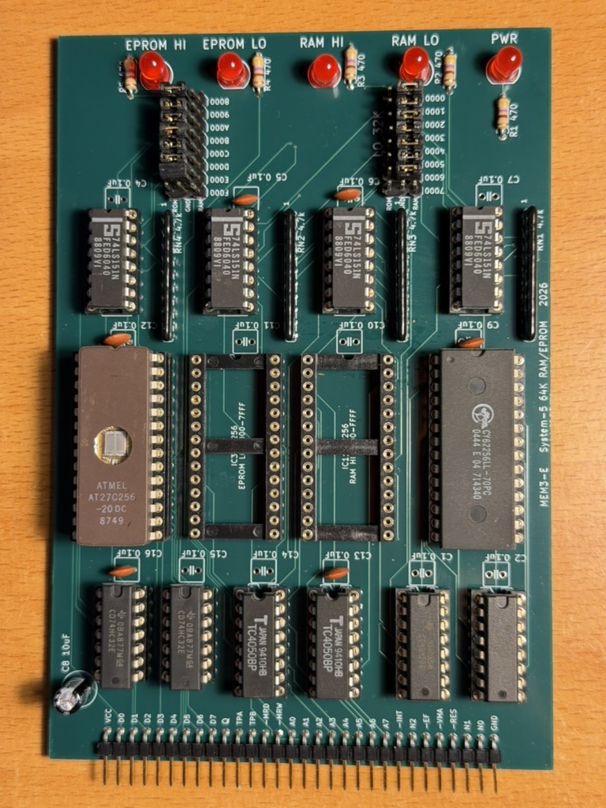

# Memory card: theory of operation

The memory card (mem3) holds up to 64K: two 32K static RAMs (62256) and two 32K EPROMs (27256), one of each in the lower 32K and in the upper 32K.
Every 4K block of the address space can be given to the RAM, to the EPROM or to neither, with jumpers, so the card can leave room for the 6845 card's video RAM and the CPU card's boot EPROM.
The total is 64K: each block holds RAM, EPROM or nothing, never both.

*MEM3-E, the memory card in the machine (photo 2026-11-15).*

- **In the machine: Rev E** (MEM3-E), `hardware/memory/kicad/rev-e/`: ordered 2026-10-20, built and brought up on 2026-10-31 (`bringup/README.md` there). Its circuit is Rev D's, net for net: Rev C (2005) plus three fixes. Rev E is a proper 4-layer board (GND and VCC planes); the Rev D boards ordered 2026-10-09 are scrap.
- **Next: Rev F** (MEM3-F), `hardware/memory/kicad/rev-f/`, drawn 2026-11-18, not ordered: Rev E with its silkscreen upright for a card standing in the bus, and **EEPROM sockets**. A 2 x 3 jumper block per EPROM socket (JP1 for IC5, JP2 for IC3) lets it take a 27C256 as before (shunts 1-3 and 2-4) or a 28C256 EEPROM on pins 1 (A14) and 27 (!WE): read-only with 3-5 alone (R6 / R7, 47k, hold !WE high), or written by the 1802 with 4-6 as well (!WE on WR). Its README has the settings and what never to fit.
- **Before it: Rev B, reworked** (PCB Fab Express FXA5474, 2005), the memory card in the machine until October 2026 (the last section).
- Design review of Rev B, with the fault that the rework and Rev C fix: `hardware/memory/REVIEW.md`.
- The 2005 description (Rev A): `hardware/memory/eagle/rev-a/ops.html`.

## Parts (Rev E)

| Ref | Part | Job |
|---|---|---|
| IC1 | 62256 | RAM, lower 32K (0000–7FFF) |
| IC11 | 62256 | RAM, upper 32K (8000–FFFF) |
| IC3 | 27256 | EPROM, lower 32K |
| IC5 | 27256 | EPROM, upper 32K |
| IC7, IC8 | CD4050B | buffers: A0–A7, -MRD, -MRW, -VMA |
| IC6, IC9 | CD4042B | latches: A8–A15 from A0–A7 on TPA |
| IC2, IC4, IC15, IC13 | 74HCT151 | 4K block select, one per chip (IC2 → IC1, IC4 → IC11, IC15 → IC3, IC13 → IC5) |
| IC14, IC12 | 74LS32 | bank select and the gated !CE of each chip |
| SV1, SV2 | 2 × 8 headers | RAM jumpers: SV2 for IC1 (0000–7000), SV1 for IC11 (8000–F000) |
| SV3, SV4 | 1 × 8 headers | EPROM jumpers: SV3 for IC3, SV4 for IC5 |
| LED1–LED5 | | +5 V; IC1, IC11, IC3, IC5 enabled |
| RN1–RN4 | 4.7 kΩ | pull-ups on the jumper (mux) inputs |

## How a cycle reaches a chip

1. **Buffers.** A0–A7, -MRD, -MRW and -VMA enter through CD4050B buffers (IC7, IC8), so the card puts one CMOS input on each bus line.
2. **High address.** The CD4042B latches (IC6, IC9), clocked by TPA with POL high, are transparent while TPA is high and hold when it falls: they capture A8–A15 from the buffered A0–A7. IC9 also gives A15 inverted, for the upper bank.
3. **Bank select.** IC14A makes the lower bank select, `-VMA OR A15`: low only for a valid address in 0000–7FFF. IC14B makes the upper one, `-VMA OR /A15`.
4. **Block select.** Each chip has a 74HCT151 8-to-1 multiplexer. A12–A14 pick one of its eight inputs, one per 4K block. Each input is pulled high by a resistor network and grounded by a jumper when that block belongs to the chip. So the mux output Y is low when the current block is jumpered for this chip.
5. **The gated !CE.** Each chip's !CE is `Y OR bank select` (74LS32: IC14C/D, IC12): low only when the chip's bank is selected **and** its block is jumpered. The LED for that chip sinks into the same !CE, so it lights while the chip is enabled.
6. **Read and write.** Buffered -MRD drives every chip's !OE; buffered -MRW drives the RAMs' !WE. A0–A14 address the chips directly (A0–A7 buffered, A8–A14 latched). Data goes straight between the chips and the bus.

Step 5 is the Rev C fix. Rev A and Rev B fed the bank select into the 74LS151's strobe (G), and G high forces Y low: a deselected bank *enabled* its chips (`REVIEW.md`, finding 1).

## Jumpers

There are two jumper fields, LO 32K (0000–7000) and HI 32K (8000–F000). Each column is one 4K block, labelled with its start address, and has three pins in a line, labelled on the silkscreen **ROM / GND / RAM**:
- the ROM row is an EPROM mux input (SV3 for IC3, SV4 for IC5);
- the GND row is one row of the 2 × 8 header (SV2 in the LO field, SV1 in the HI field);
- the RAM row is that header's other row (the RAM mux inputs for IC1 or IC11).

A jumper from GND up to ROM gives the block to the EPROM, from GND down to RAM gives it to the RAM; no jumper leaves it empty. One jumper per column, so a block can never be both.

**The System-5 setting** (`RRRRRRR-EEEEEEE-`, block 0 first): RAM 0000–6FFF, nothing at 7000 (the 6845 card), EPROM 8000–EFFF, nothing at F000 (the CPU card's boot EPROM).

## LEDs (Rev D/E)

| LED | Lights while |
|---|---|
| LED1 | +5 V is on |
| LED2 | IC1 (RAM, lower) is enabled |
| LED3 | IC11 (RAM, upper) is enabled |
| LED4 | IC3 (EPROM, lower) is enabled |
| LED5 | IC5 (EPROM, upper) is enabled |

Each runs +5 V → LED → 470 Ω → the chip's gated !CE, so it lights at full brightness only while its chip is selected. With the CPU running they glow at a brightness that shows how busy each chip is.

## Building Rev E

- **74HCT151, not 74LS151**, for all four muxes. Each CD4042B output (A12–A14) drives four mux select inputs; four LS inputs need up to 1.6 mA, more than a CD4042B can sink at a valid low. HCT inputs draw about 1 µA.
- **Keep the CD4050B buffers.** A faster 74HC4050 makes the start-of-cycle overlap (C1, below) slightly worse.
- EPROM VPP is tied to VCC on Rev D/E (Rev C grounded it).

**The card as built (2026-10-31)** is fitted for the System-5 setting only: the lower RAM IC1 and the upper EPROM IC5, with their muxes IC2 and IC13. IC3, IC11, their muxes IC4 and IC15, and RN2 and RN3 are not fitted. IC5 is a Toshiba TC57256D holding the ELF/OS install ROM. Tested from the bus driver, the RAM passes over all of 0000–6FFF and the EPROM reads back correctly over all of 8000–EFFF; one faulty 74HCT151 (IC2) was replaced on the way (`hardware/memory/kicad/rev-e/bringup/README.md`).

## Known points

- **C1** (`hardware/TIMING-REVIEW.md`): the chip enable settles late (the CD4042B, up to about 220 ns), so at the start of a read the card can drive the bus while another card does, for up to about 230 ns in the worst case. It is noise, not a wrong read: the 1802 latches data about 3 µs later. The fix is a faster address latch, a layout change for a later revision.

## Rev B as built (the card in the machine until October 2026)

The built Rev B has red-wire rework: the RAM's and the EPROM's !CE pins are lifted and wired to the 74LS32 (IC14), to get round Rev B's chip-select fault (`hardware/memory/REVIEW.md`). It was the machine's memory card until MEM3-E replaced it on 2026-10-31.

The emulator's model of this card, `--mem-rev B-built`, was derived from the photos: it takes the wires to the bank selects, so that the jumpers do nothing, the RAM (IC1) answers all of 0000–7FFF and the EPROM (IC5) all of 8000–FFFF. **The card itself did not behave that way.** Tested from the bus driver on 2026-10-30, its RAM was good over 0000–6FFF and nothing answered at 7000–7FFF: the rework keeps the jumper decode, so the RAM and the 6845 card never overlapped, and the model is wrong on that point (`hardware/memory/eagle/rev-b/bringup/README.md`). The photos also show more rework than the model has (several IC14 pins lifted, a solder bridge).

In the same tests the card's EPROM read wrong, and after a further rework (IC5's VPP pin to VCC) the RAM stopped answering as well. The card was not repaired: MEM3-E was built instead.
