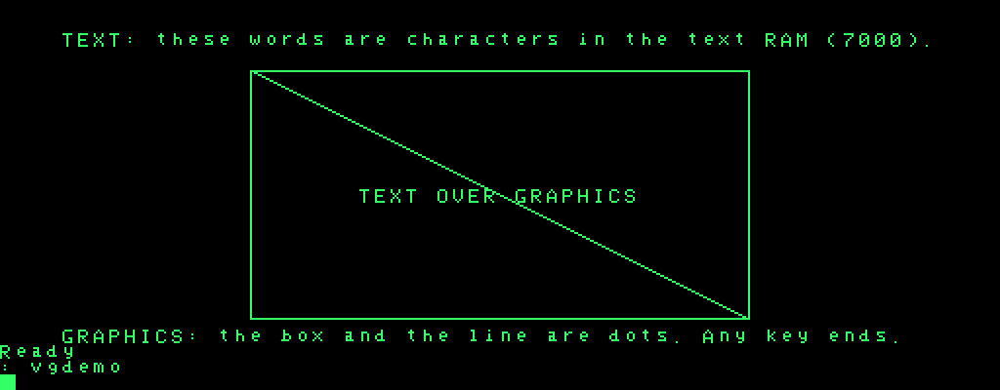

# System-5 programs for Elf/OS v5

Programs of our own for Mike Riley's Elf/OS v5 on System-5, and a tool that puts them on a v5 card image. Mike
Riley's own programs and the card image are third-party and stay in the private repository:
`../private-resources/elf/reference/mike-riley/elfos-v5/`.

| Here | What |
|---|---|
| `cls/cls.asm` | `cls` for System-5: clears the screen of the 6845 card (16 lines) or of VIDEO-G (25 lines) |
| `cls/cls`, `cls/cls.lst` | the Elf/OS program built from it (86 bytes) and its listing |
| `vgdemo/vgdemo.asm` | a small demo for VIDEO-G: words written to the text RAM, a box and a line to the graphics (2026-11-20) |
| `vgdemo/vgdemo`, `vgdemo.lst`, `vgdemo.png` | the program (426 bytes), its listing, and the picture it makes in the emulator |
| `build.py` | assembles the programs with `tools/asm1802.py`; `--check` says whether the built ones match their source |
| `v5card.py` | lists a v5 card image, copies a file off it, replaces a file on it, and adds one (`add`, 2026-11-15) |

## cls

Mike Riley's `cls` types `ESC[H` and `ESC[2J`, the codes that home the cursor and clear the screen of an ANSI
terminal. HBIOS's screen is not an ANSI terminal, so on System-5 it showed `[H[2J` and cleared nothing.

This `cls` writes spaces over the screen itself. HBIOS types on the bottom line and scrolls the rest up, so there is
no "home": the cursor stays at the start of the bottom line, and after `cls` the screen holds only `Ready` and the
`:` prompt at the bottom. It takes 0.8 seconds at 2 MHz and 3.2 at 500 kHz on the 6845 card, most of it Elf/OS
loading the program.

- **One program for both video cards (build 2, 2026-11-20).** The screen starts at 7000, 64 characters a line: 16
  lines on the 6845 card (7000-73FF), 25 on VIDEO-G (7000-763F). HBIOS keeps its cursor's address in the last two
  bytes of the video RAM (77FE, 77FF), and when `cls` runs the cursor is on the bottom line: 73C0 on the 6845 card,
  7600 on VIDEO-G. So `cls` clears from 7000 to the end of the line the cursor is on. If those two bytes do not hold
  an address a cursor can have, it clears the 6845 card's 16 lines. Build 1 (2026-11-14) cleared 7000-73FF whatever
  the card, which left VIDEO-G's lines 16-24 as they were.
- It is for HBIOS (1.0.4 to 1.0.8, and the VIDEO-G build): it writes to the video RAM without asking what is there.
- `ver /bin/cls` shows `11/20/2026 12:0:0 Build: 2  System-5 screen` (build 1: `11/14/2026 ... System-5 6845
  screen`). Mike Riley's says `Written by Michael H. Riley`.
- Build 1 was tried in the s5emu emulator (2026-11-14), by Ken in the v5 Codespace the same day, and on the real
  machine with HBIOS 1.0.6 (2026-11-15, Ken): it works. Build 2 has run in the emulator only, on both cards
  (2026-11-20). **The real 16 MB card still has build 1**, which is right for the 6845 card it runs with.

## vgdemo: writing to VIDEO-G's text and to its graphics

Ken, 2026-11-20: "a small demo showing writing to text and writing to graphics". `vgdemo` at the Elf/OS prompt:

1. **Text.** It stores spaces over rows 0-21 and then three lines of words, straight into the text RAM: a character
   stored at 7000 + 64 x row + column is on the screen at once.
2. **Graphics on.** It writes 02 to the control register (7804): bit 1 is GFX-ON and bit 0, TEXT-OFF, stays 0, so
   the monitor shows both. The graphics RAM holds whatever it powered up with, so stray dots show first.
3. **Graphics.** For each of the 200 lines it writes the line's number to the Y register (7806); the 64 bytes at
   7C00-7C3F are then that line's 512 dots. It clears the line, and inside the box draws the top or bottom (bytes of
   FF), or the two edges and two dots of the diagonal, which it ORs into the byte it reads back from the window.
4. It waits for a key (status 7804 bit 0, the key at 7802), turns the graphics off (control = 00) and returns.

The words in the middle of the box are text and the box and the line are graphics: where they cross, the card ORs
the two. About 1.4 seconds at 2 MHz. It asks the card what it is first (status bits 7-6 = 10 and bit 5, GFX fitted)
and on any other video card says `vgdemo needs the VIDEO-G card with its GFX board` and touches nothing: on the 6845
card those addresses are the 6845's own registers. It is on the card image in `private-resources` (`/bin/vgdemo`).
Emulator only: VIDEO-G is not built. To see it:

    python3 -m s5emu --video g --disk <a copy of the v5 card image> --ui tui     (from software/s5emu)
    test>B                      boot Elf/OS
    : vgdemo
    png /tmp/vgdemo.png screen 2    (in the emulator's debugger: the picture as a PNG)

## Building and putting it on the card

    python3 software/elfos-v5/build.py

    python3 software/elfos-v5/v5card.py put ../private-resources/elf/reference/mike-riley/elfos-v5/system5/elfos-5.1.1-system5-16mb.img.gz /bin/cls software/elfos-v5/cls/cls

The image in `private-resources` has had this `cls` since 2026-11-14 (build 2 since 2026-11-20, with `vgdemo`,
added with `v5card.py add -x`). `v5card.py put` only replaces a file that is on the card already, in the lumps it
already has: for `cls` it changed two sectors of the image, 48 (the length in `/bin`'s directory entry) and 304 (the
program). Mike Riley's `cls` is still on the card inside `base.lbr`.

    python3 software/elfos-v5/v5card.py ls IMAGE /bin

lists the programs on a card image with their sizes and lumps.

    python3 software/elfos-v5/v5card.py add -x IMAGE /bin/minimon minimon.bin

adds a new file (2026-11-15), as v5 itself does when it makes one (watched in s5emu: `copy /bin/ver /bin/vertest`):
the lowest free lumps, chained in the allocation table, and the first free entry of the directory; nothing else on
the card changes. `-x` marks it executable (flags 12h, as the programs `lbr` unpacks; 10h without). The directory
must exist and have a free entry. It put MINIMON and Rc/Basic Level 2 on the real 16 MB card on 2026-11-15: three
places changed for MINIMON (sector 17, `/bin`'s directory sector, its lump), Disktool5's `fsck` found the card sound,
and both run on the machine.

Tests: `test_elfos_v5_cls_is_the_system5_one` and `test_elfos_v5_boots_from_disk` in
`software/s5emu/tests/test_machine.py` (the 6845 card), and `System` in `software/s5emu/tests/test_newset.py`
(VIDEO-G: `cls` on 25 lines, and `vgdemo` dot for dot); all skipped without the private image.

## Which of Mike Riley's programs send ANSI codes

A scan of every program on the v5 card and in his release (2026-11-14) found three; no other program and not
the kernel holds an escape code.

| Program | Codes | On System-5 |
|---|---|---|
| `cls` | `ESC[H` (cursor home), `ESC[2J` (clear the screen) | replaced by the `cls` here |
| `visual02` | `ESC[2J`, `ESC[J` (clear to the end of the screen), `ESC[row;colH` (put the cursor at a place) | cannot run: it loads at 6000-704A, across the kernel's heap and into the video RAM, and draws for an 80 x 24 screen. Making it work at other addresses is in `BACKLOG.md` (Ken, 2026-11-14) |
| `ur` (in his release, not on the card) | `ESC[H`, `ESC[2J` | not tried |

The other way to deal with them is in the ROM: HBIOS could act on the codes as they are typed. HBIOS 1.0.5 has
room for a small routine (207 free bytes at FC31-FCFF). It could clear the screen and swallow the other codes, but
not place the cursor, because HBIOS types on the bottom line only; and it would need a new EPROM. Not done: it is
in `BACKLOG.md` (Ken, 2026-11-14), so that programs need not be rewritten as `cls` was.
